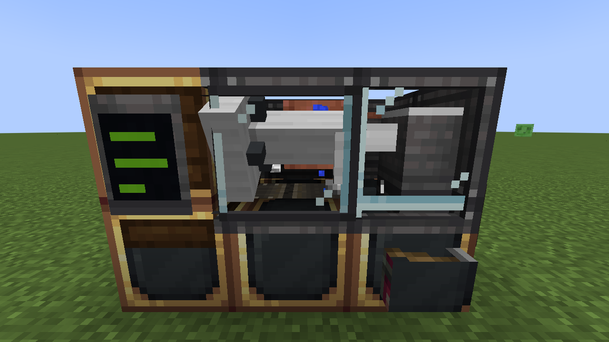
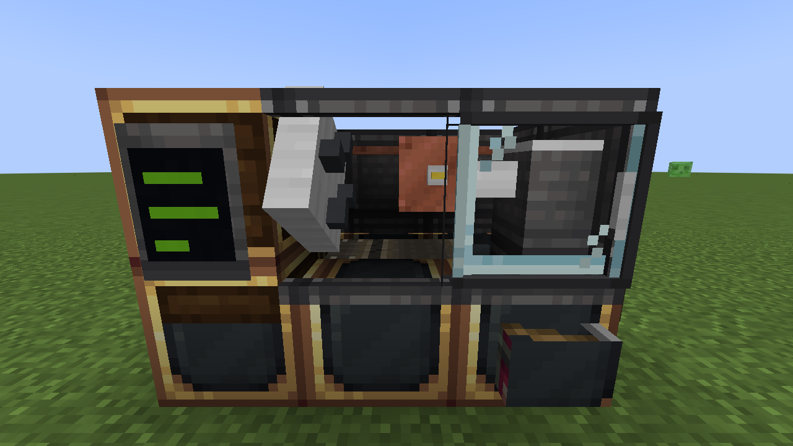
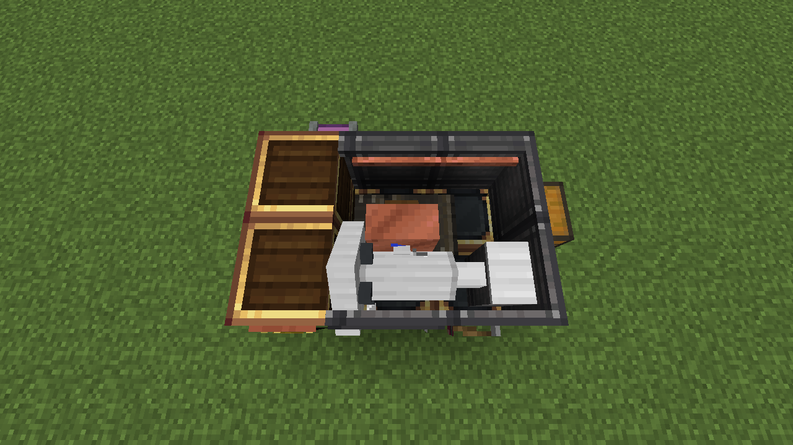

# Create: Machining

Precision machining for [Create](https://github.com/Creators-of-Create/Create): CNC lathes, mills, tooling, and the hum of a spindle at speed.

**Targets:** Minecraft 1.21.1 · NeoForge · Create 6.0.10+

## What's in v0.4



### CNC Lathe (multiblock)
A 3 wide × 2 deep × 2 tall machine, placed from a single item: the block you aim at becomes the front-left (headstock) corner and the door faces you. Break any piece and the whole machine drops as one item.

- **Power:** shaft into the back of the lower headstock block. 8 SU/RPM.
- **Cycle:** door slides shut → turret plunges, traverses the cut, retracts → door opens. Twice as fast as the Bench Lathe; same recipes, RPM bands and quality rules. The door is interlocked while it runs.
- **By hand (right-click):** chuck or door → load stock / pull parts (then stock); turret → load or remove a Carbide Insert; chip tray → empty it, or install the **chip conveyor** with a Mechanical Belt.
- **Ports (funnels, chutes, hoppers):** chuck end face → stock in (future bar feeder); turret → inserts in; parts catcher (lower front, tailstock end) → parts out; chip outlet (lower back, tailstock end) → chips out, only with the conveyor installed, which also pushes chips into whatever is at the outlet.
- **Chip tray:** swarf goes here, not in with the parts. A full tray stops the machine.
- **Coolant:** on by default for now (spray particles); supply requirements come later.
- **Recipe:** 5×7 Mechanical Crafting: industrial iron enclosure, brass casing headstock, electron tube, framed glass door, precision mechanisms, 3 Bearing Assemblies, sturdy sheets, a large cogwheel, fluid pipes and an andesite casing base.

| Idle, door open | From above, mid-traverse |
|---|---|
|  |  |

### Bench Lathe
The original single-block lathe. Takes rotational power through the back of the headstock. Needs **stock** and a **Carbide Insert** loaded (right-click, belt, funnel or hopper). Pull finished parts out by right-clicking with an empty hand, or with a funnel/hopper.

| Recipe | Ideal spindle speed |
|---|---|
| Iron ingot → 2 Iron Bushings (+50% Iron Swarf) | 32–96 RPM |
| Brass ingot → 2 Brass Bushings (+50% Brass Swarf) | 64–192 RPM |
| Rework: a *Needs Rework* bushing → skim cut → fresh, uninspected bushing | same bands |

Higher RPM = shorter cycle, but running outside the band costs quality. Stress impact: 4 SU/RPM. Engineer's Goggles show insert life and whether you're in band. Parts from one setup pool into a single uninspected lot in the lathe's output.

### Part quality
Behind the scenes every part gets a gage % (see `content/quality/QualityModel.java`):

- **Speeds**: 1.0 inside the band, dropping 60% per 100% you're outside it (floor 0.2). The worst speed during the cycle counts.
- **Tool wear**: gentle wear across the first 75% of insert life (1.0 → 0.9), then a breakdown zone (0.9 → 0.5). Overspeeding wears inserts twice as fast.
- `gage = round(95 × speed × tool) + random 0–5`

The **Inspection Station** (2 s per part) turns that into a grade:

| Grade | Gage | Disposition |
|---|---|---|
| Perfect | ≥ 95% | Anything, including **precision** recipes |
| In-Tolerance | 85–94% | Standard recipes |
| Out of Tolerance | 75–84% | *Use as-is*: standard recipes accept it, but the assembly may scrap |
| Needs Rework | 60–74% | Back to the lathe for a skim cut |
| Scrap | < 60% | Crushing Wheels → swarf → nuggets |

### Assemblies (Create sequenced assembly)
- **Bearing Assembly**: Iron Sheet → deploy Brass Bushing → deploy Andesite Alloy → press. In-Tolerance or better always succeeds; an Out of Tolerance bushing has a 30% chance the press fit fails (you get Brass Swarf).
- **Precision Mechanism, machined route** *(precision)*: Golden Sheet → deploy **Perfect** Iron Bushing → deploy Cogwheel → deploy Large Cogwheel. One pass, never fails (Create's own route takes 5 loops and can fail).

### Other
- Swarf → Crushing Wheels → nuggets.
- Carbide Inserts: compact iron ingot + coal + flint on a heated Blaze Burner → 2 inserts (64 cuts each).
- Recipes can check grades with NeoForge's component ingredient: `{"type": "neoforge:components", "items": "create_machining:iron_bushing", "components": {"create_machining:grade": "perfect"}}`

## Testing

- `./gradlew test` runs the unit tests for the quality math.
- `./gradlew runGameTestServer` boots a headless world and runs the in-game tests (lathes, Creative Motor, inspection station, the CNC multiblock and its ports).
- `tools/screenshots.sh` (Linux with Xvfb + Mesa) films the CNC Lathe in a real client and saves PNGs to `run/screenshots/`.

## Models
The CNC Lathe's models are generated from one machine description: edit `tools/gen_cnc_lathe_models.py`, then run `python3 tools/gen_cnc_lathe_models.py`.

## Setting up (first time)

1. Install **IntelliJ IDEA Community Edition**.
2. **File → Open** and pick this folder. IntelliJ sees `build.gradle` and imports it as a Gradle project. If it asks for a JDK, have it download **Java 21** (any vendor, e.g. Temurin).
3. The first import is slow because it downloads Minecraft, NeoForge and Create. Let it finish.
4. Open the **Gradle** tab on the right side and run **create-machining → Tasks → mod development → runClient**. A dev copy of Minecraft opens with Create, JEI and our mod loaded.

To build a jar you can drop into a real CurseForge instance, run **build → build**. The jar ends up in `build/libs/`.

## Project layout

```
src/main/java/com/jessehandke/createmachining/
  CreateMachining.java          entry point: registers everything
  registry/                     lists of blocks, items, block entities, recipe types, creative tab
  content/lathe/                Bench Lathe, turning recipe, shared lathe rules (LatheLogic)
  content/cnc/                  CNC Lathe: controller, structural blocks, layout math, cycle logic
  content/inspection/           the inspection station
  content/quality/              quality math (pure Java, unit tested)
  gametest/                     in-game automated tests
  client/                       renderers (spindles, the CNC Lathe's moving parts), tooltips
  client/dev/                   screenshot director (dev tool, off in normal play)
src/main/resources/
  assets/create_machining/      models, textures, translations (client-side looks)
  data/create_machining/        recipes, loot tables (server-side rules)
```
